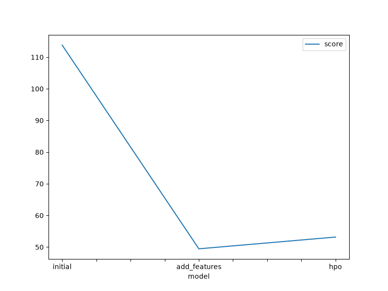

# Report: Predict Bike Sharing Demand with AutoGluon Solution
#### by Karol

## Initial Training
### What did you realize when you tried to submit your predictions? What changes were needed to the output of the predictor to submit your results?
In order to submit predictions, I had to express them in format that can be understood by Kaggle API.
I had to prepare CSV file with one column that contains predictions for each sample from test set. 
Additionally, I had to make sure that none of prediction is negative: all negative predictions were replaced by zero.

### What was the top ranked model that performed?
The best performing model archived for first submission was **WeightedEnsemble_L3** with Kaggle score **1.42360**.

## Exploratory data analysis and feature creation
### What did the exploratory analysis find and how did you add additional features?
While performing exploratory analysis I found out the distributions of all variables:
* binary variables are **holiday**, **workingday**, **season fall*, **season_spring**, **season_summer**, **season_winter**, **weather_clear**, **weather_cloudy**, **weather_heavy_rain**, **weather_snow_or_rain**
* **temp**, **atemp**, **humidity**, **windspeed** have normal distributions (some are skewed)
* **count** has exponential distribution
* **datetime_hour**, **datetime_day**, **datetime_month** almost have uniform distribution (with few peaks)

Following features were introduced:
- I represented **datetime** as **hour**, **day**, **month** (**datetime** is represented as numeric value, however, it's very useful for Machine Learning, because we look for some patterns that happens at specific hours every day or in specific seasons `month`, `day`)
- `season` and `weather` were encoded using **one-hot encoding** (following variables are not ordinal category variables (there is no correlation between options), so it makes more sense to represent them as binary variables)

### How much better did your model preform after adding additional features and why do you think that is?
After performing above transformations, our models performed better. Kaggle score value for the best model decreased from **1.42360** to **0.55003**
I think performed actions/transformations allowed models better understand patterns hidden in training set.

## Hyper parameter tuning
### How much better did your model preform after trying different hyperparameters?
Hyperparameters' optimization allowed to slightly improve Kaggle score: it described from **0.55003** to **0.54201** .

### If you were given more time with this dataset, where do you think you would spend more time?
If I had more time, I would defensively spend more time on hyperparameters' optimization. I would try to:
* optimize different hyperparameters of top 3 models
* optimize models that performed worse than top 3 models at second submission

Additionally, we could try do more feature engineering.

### Create a table with the models you ran, the hyperparameters modified, and the kaggle score.
| model        | ensemble_size     | subsample_size | max_base_models | score   |
|--------------|-------------------|----------------|-----------------|---------|
| initial      | default           | default        | default         | 1.42360 |
| add_features | default           | default        | default         | 0.55003 |
| hpo          | 0.679753950286893 | 988            | 3               | 0.54201 |

### Create a line plot showing the top model score for the three (or more) training runs during the project.

### Create a line plot showing the top kaggle score for the three (or more) prediction submissions during the project.

## Summary
During this task **Auto Gluon** was employed to solve regression problem **Bike Sharing Demand Prediction**.
Multiple regression models were trained. In order to improve performance data engineering techniques were used:
categorial variables were encoded using one-hot encoding, timestamps were transformed to be expressed as separate features: month, day, hour.
In order to polish obtained models, hyperparameters optimization was performed.
